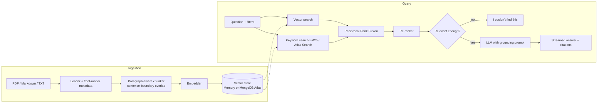

# Enterprise Knowledge Assistant

A question-answering assistant over company documents (policies, SOPs, guides) that answers with **citations**, says **"I couldn't find this"** instead of guessing, and comes with an **evaluation suite** that measures retrieval quality, answer accuracy and hallucination rate.

Built as a production-style RAG system rather than a notebook demo: hybrid retrieval, re-ranking, metadata filters, a streaming API, MongoDB Atlas Vector Search, Docker and CI with an evaluation gate.

```
$ eka ask "Who approves a purchase above 5 lakh?" --department Finance
Above Rs 5,00,000: approved by the department head, the finance controller and the CFO. [1]
  [1] Procurement SOP (procurement_sop.md)
```

## Why this project

Most RAG demos stop at "embed the PDF, ask a question". In a company the hard parts are different:

- **Exact terms matter.** "Form HR-07", "e-way bill", "M3 grade". Pure vector search blurs these, so retrieval here is **hybrid**: dense vectors plus BM25 keyword search, merged with Reciprocal Rank Fusion.
- **Answers must be traceable.** Every sentence carries a source number, and the API returns the snippet it came from.
- **Not knowing is a valid answer.** If nothing relevant is retrieved, the assistant declines instead of inventing a policy.
- **You need numbers before you change anything.** The evaluation suite turns "it seems better" into hit rate, MRR, answer accuracy, faithfulness and refusal accuracy, and CI fails if they drop.

## Architecture



| Component | Implementation |
|---|---|
| Loaders | `.md` (with front-matter), `.txt`, `.pdf` via pypdf. Department falls back to the folder name |
| Chunking | Packs paragraphs up to 700 chars; long paragraphs split on sentences; overlap starts on a sentence boundary |
| Embeddings | OpenAI `text-embedding-3-small`, or an offline hashing embedder (unigrams + bigrams) |
| Dense search | NumPy cosine search, or MongoDB Atlas `$vectorSearch` with filters pushed into the index |
| Keyword search | BM25 (Lucene IDF), or Atlas Search `$search` with a compound filter |
| Fusion | Reciprocal Rank Fusion, `k = 60` |
| Re-ranking | IDF-weighted term coverage + phrase match; optional cross-encoder via `EKA_RERANKER=cross-encoder` |
| Generation | OpenAI or Claude with a citation-enforcing prompt; offline extractive answerer as a baseline |
| API | FastAPI: `/ask`, `/ask/stream` (Server-Sent Events), `/ingest` (file upload), `/health`, optional API-key auth |
| Evaluation | 30 labelled questions incl. unanswerable ones; LLM-as-judge or token-overlap faithfulness |

## Quick start (no API keys needed)

```bash
git clone https://github.com/rahuldahiya67/enterprise-knowledge-assistant
cd enterprise-knowledge-assistant
python -m venv .venv && source .venv/bin/activate      # Windows: .venv\Scripts\activate
pip install -e ".[all,dev]"

eka ingest data/sample_docs --reset
eka ask "How many days of annual leave do permanent employees get?"
eka eval
eka serve            # http://localhost:8000/docs
```

The default **offline mode** uses a hashing embedder and an extractive answerer, so everything above runs without keys or internet. It is also the baseline the evaluation compares against.

## Using real models

```bash
cp .env.example .env
```

| Goal | Set in `.env` |
|---|---|
| Answers from GPT | `EKA_LLM_PROVIDER=openai`, `EKA_OPENAI_API_KEY=sk-...` |
| Answers from Claude | `EKA_LLM_PROVIDER=anthropic`, `EKA_ANTHROPIC_API_KEY=sk-ant-...` |
| Neural embeddings | `EKA_EMBEDDING_PROVIDER=openai` (re-run `eka ingest --reset` after changing) |

With a real LLM provider, `eka eval` automatically switches faithfulness checking to an **LLM-as-judge**.

## MongoDB Atlas Vector Search

```bash
# Option A: Atlas in the cloud (free M0 cluster works)
EKA_VECTOR_STORE=mongo
EKA_MONGO_URI=mongodb+srv://<user>:<password>@<cluster>.mongodb.net

# Option B: Atlas locally in Docker
docker compose --profile mongo up -d mongo
EKA_MONGO_URI=mongodb://localhost:27017/?directConnection=true
```

```bash
eka setup-mongo                      # creates the vector index + text index
eka ingest data/sample_docs --reset
```

The vector index declares `department`, `doc_type` and `effective_date` as **filter fields**, so metadata filters run inside `$vectorSearch` (pre-filtering) instead of discarding results afterwards.

## API

```bash
curl -X POST localhost:8000/ask -H "content-type: application/json" \
  -d '{"question": "What is the hotel limit per night outside metro cities?", "department": "Finance"}'
```

```json
{
  "question": "What is the hotel limit per night outside metro cities?",
  "answer": "Hotel stays are capped at Rs 6,000 per night in metro cities and Rs 4,000 per night elsewhere, excluding taxes. [1]",
  "citations": [{"index": 1, "title": "Travel and Expense Policy", "source": "travel_expense_policy.md", "department": "Finance", "snippet": "..."}],
  "grounded": true
}
```

| Endpoint | Purpose |
|---|---|
| `POST /ask` | Answer with citations. Optional filters: `department`, `doc_type`, `effective_after` |
| `POST /ask/stream` | Same, streamed as SSE: `token` events, then a `done` event with citations |
| `POST /ingest` | Upload `.md` / `.txt` / `.pdf` files (multipart) |
| `GET /health` | Index size and active providers |

Set `EKA_API_KEY` to require an `X-API-Key` header on everything except `/health`.

## Evaluation

```bash
eka eval --cases eval/cases.jsonl --report reports
```

Each case in `eval/cases.jsonl` lists the question, the documents that should be retrieved, the key facts the answer must contain, and whether it is answerable at all. Four questions are deliberately **unanswerable** (stock options, CEO name, cafeteria menu, car lease) to test that the assistant declines.

Results for the **offline baseline** (hashing embeddings + extractive answerer), 30 cases:

| Metric | What it measures | Score |
|---|---|---|
| hit_rate@5 | an expected source is in the top 5 | **1.00** |
| recall@5 | share of expected sources retrieved | **1.00** |
| MRR | rank of the first relevant chunk | **1.00** |
| answer_accuracy | key facts present in the answer | **0.96** |
| faithfulness | answer sentences supported by context | **1.00** |
| hallucination_rate | answers with any unsupported sentence | **0.00** |
| refusal_accuracy | declines unanswerable, answers answerable | **0.97** |

The one miss is instructive: *"What is the minimum password length?"* The policy says passwords must be *"at least 12 characters long"*. No word overlaps except "password", so the lexical baseline declines. Neural embeddings close exactly this paraphrase gap, and the eval makes that measurable. Full per-question results are in [`reports/eval_report.md`](reports/eval_report.md).

CI runs the evaluation on every push and fails if answer accuracy drops below 0.9.

## Project structure

```
src/eka/
  config.py       settings from env / .env
  models.py       Document, Chunk, filters, Answer
  ingest.py       loaders + chunking
  embeddings.py   OpenAI + offline hashing embedder
  stores.py       MemoryStore (cosine + BM25), MongoAtlasStore ($vectorSearch + $search)
  retrieval.py    hybrid retrieval, RRF, re-rankers
  llm.py          OpenAI / Claude / offline generators, grounding prompt
  pipeline.py     ingest -> retrieve -> generate -> cite
  evaluation.py   metrics, judges, reports
  api.py          FastAPI app
  cli.py          `eka` command
data/sample_docs/ 8 sample documents for a fictional manufacturer, across 5 departments
eval/cases.jsonl  30 labelled evaluation questions
tests/            46 tests (provider SDKs and MongoDB are faked, so no network is needed)
```

## Design decisions

- **Reciprocal Rank Fusion instead of weighted score blending.** BM25 scores and cosine similarities live on different scales; RRF only uses ranks, so it needs no calibration and is robust when one retriever returns nothing.
- **Refuse before calling the LLM.** If the best re-ranked chunk is below `EKA_MIN_RELEVANCE`, the pipeline answers "I couldn't find this" without an LLM call. That saves cost and removes the most common source of hallucination: a model trying to be helpful with irrelevant context.
- **Overlap on sentence boundaries.** Character-based overlap produced chunks starting mid-sentence, which then showed up as broken citation snippets. Overlap now carries whole sentences only.
- **Own BM25 with Lucene IDF.** Classic Okapi IDF goes negative for terms in more than half the documents, which silently dropped matches in small, focused collections.
- **Offline mode as a first-class provider.** Tests, CI and demos never depend on an API key, and the offline scores are the baseline that real models must beat.

## Possible next steps

- Add a cross-encoder or Cohere re-ranker and compare against the lexical re-ranker in the eval
- Query rewriting for follow-up questions in a chat session
- Per-user access control on documents (filter by the user's departments)
- Track eval metrics over time in a small dashboard

---

Sample documents describe a fictional company and are for demonstration only.
